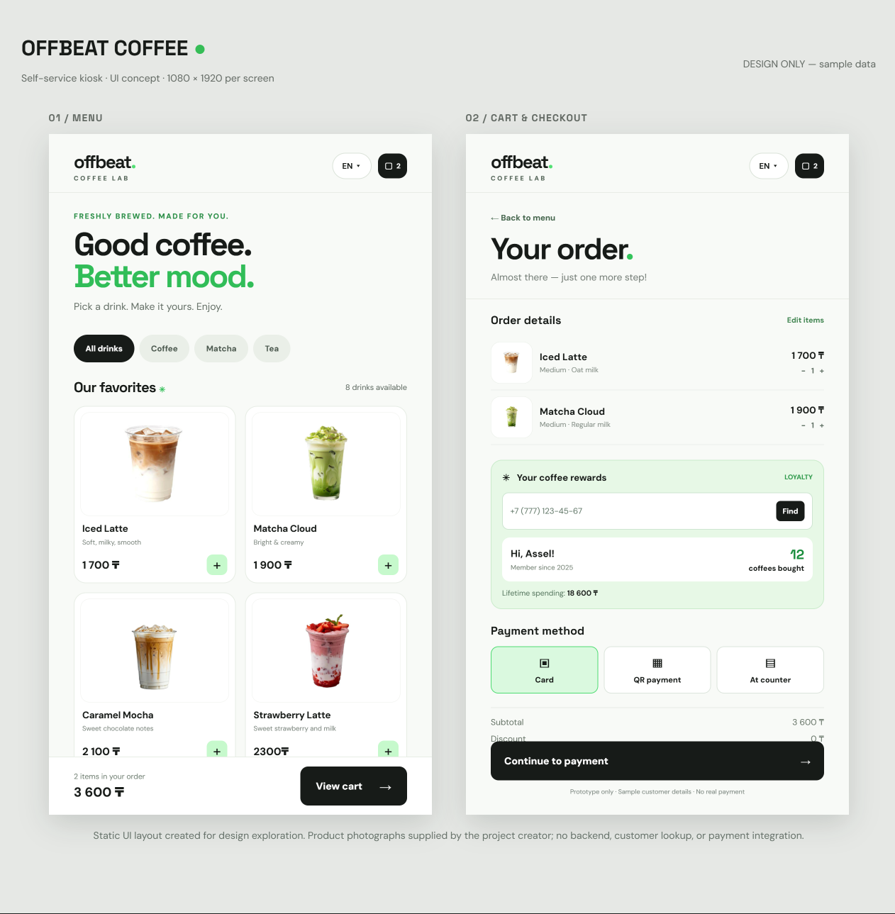

# OFFBEAT Coffee — Self-Service Kiosk UI Concept

A two-screen **UI/UX design concept** for a self-service coffee ordering kiosk.

## Screens

- **Menu:** drink categories, product photography, descriptions, prices, and cart entry point.
- **Cart & Checkout:** selected drinks, loyalty-phone lookup concept, example customer purchase history, order total, and payment-method options.

## Design approach

- Touchscreen-friendly layout and clearly organized information
- Consistent product-photo sizing and alignment
- Minimal light interface with green accents
- Sample content to illustrate the loyalty program

## View locally

Download the repository and open `index.html` in a browser. Keep the `images/` folder beside the HTML file.

## Project status

**Design-only prototype.** The HTML file is a static visual layout. The loyalty lookup, cart updates, and payments are **not** connected to a backend. All customer information is fictional. The screenshot is an exported design preview and may differ slightly from the HTML version.

## Tools

Figma Make, HTML, CSS.

## Credits

Drink photographs supplied for this portfolio project. Verify rights to publicly redistribute third-party photographs before publishing the repository.
